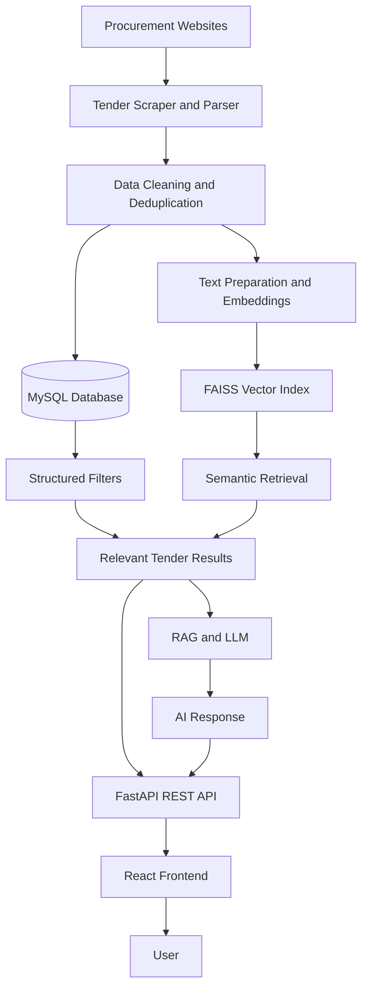

# Tender AI — AI-Powered Government Tender Search & Discovery

**An AI-powered platform for discovering, filtering, and understanding government procurement opportunities using semantic search, vector embeddings, and Retrieval-Augmented Generation (RAG).**


---

## Overview

**Tender AI** is an AI-powered tender discovery platform designed to simplify how users find and explore government procurement opportunities.

Government tender information can be distributed across multiple websites and published in different formats. Manually reviewing these notices to identify relevant opportunities can be time-consuming.

Tender AI addresses this challenge by combining tender data collection, structured database filtering, semantic search, and conversational AI in one application.

Users can search for tenders using keywords, apply filters such as organization, category, location, and closing date, and use natural-language queries to discover opportunities based on their requirements.

The platform is designed around a Retrieval-Augmented Generation (RAG) workflow, where relevant tender information is retrieved from available data to support AI-generated responses.

## Problem Statement

Traditional tender discovery often involves:

- Manually browsing multiple procurement websites.
- Reviewing large numbers of tender notices.
- Finding relevant opportunities using exact keywords.
- Tracking tender deadlines and publication dates.
- Identifying tenders that match a particular organization, location, or category.
- Extracting useful information from unstructured tender documents.

## Solution

Tender AI brings these activities into an AI-assisted search and discovery workflow.

- **Centralized discovery:** Collect and organize tender information from supported sources.
- **Structured filtering:** Narrow results using database fields such as organization, category, location, and status.
- **Semantic retrieval:** Find relevant tenders using vector embeddings rather than relying exclusively on exact keyword matches.
- **Conversational search:** Ask questions about tender opportunities in natural language.
- **Context-aware responses:** Retrieve relevant tender information to provide context for AI-generated answers.

## Key Features

### 1. Tender Data Collection

- Collect tender information from supported procurement sources.
- Parse and normalize available tender fields.
- Store structured records in a relational database.
- Support duplicate detection to reduce repeated records.

### 2. Intelligent Tender Search

- Keyword-based search.
- Natural-language query processing.
- Semantic search using text embeddings.
- Vector similarity search using FAISS.
- Filter-based retrieval to narrow down relevant results.

### 3. Advanced Filtering

Search and filter tender records using available fields, including:

- Organization
- Department
- Category
- Location
- Publication date
- Closing date
- Tender status

The available filters depend on the fields present in the collected tender data.

### 4. AI-Powered Chatbot

- Ask questions about available tender opportunities.
- Retrieve relevant tender information as context for AI responses.
- Support conversational exploration of procurement data.
- Connect language-model responses with the platform's retrieval pipeline.

### 5. Vector Search and Embeddings

- Generate numerical vector representations of tender text.
- Store and retrieve vectors using FAISS.
- Associate vector records with tender metadata.
- Use semantic similarity to identify relevant results.

### 6. Backend API

- REST API built with FastAPI.
- Structured request and response handling.
- Database-backed tender retrieval.
- API documentation through FastAPI's interactive Swagger UI.

---

## System Architecture

The application separates data collection, storage, retrieval, and the user interface.



### Architecture Components

| Component | Responsibility |
|---|---|
| Data collection | Collects tender information from supported procurement websites. |
| Parser and processor | Extracts, normalizes, and prepares tender records. |
| MySQL | Stores structured tender information and associated metadata. |
| Sentence Transformers | Converts text into numerical embeddings. |
| FAISS | Performs vector similarity search over indexed tender content. |
| Retrieval pipeline | Finds relevant tender records using semantic retrieval and applicable filters. |
| RAG and LLM | Uses retrieved context to generate conversational responses. |
| FastAPI | Exposes backend functionality through REST endpoints. |
| React | Provides the user-facing search and chatbot interface. |

*The diagram represents the intended high-level architecture. The precise execution order and integration of components depend on the current implementation.*

---

## Technology Stack

### Backend

- **Python** — Core application logic and data processing.
- **FastAPI** — REST API framework.
- **SQLAlchemy** — Database ORM.
- **PyMySQL** — MySQL connectivity.
- **Uvicorn** — ASGI server.

### Artificial Intelligence and Search

- **Sentence Transformers** — Text embedding generation.
- **BAAI/bge-small-en-v1.5** — Embedding model used in the current project configuration.
- **FAISS** — Vector similarity search and indexing.
- **Retrieval-Augmented Generation (RAG)** — Retrieval-grounded AI responses.
- **Groq / Llama** — Language-model integration in the current project configuration.

### Database and Storage

- **MySQL** — Structured tender records.
- **FAISS index** — Local vector index storage.
- **Pickle metadata** — Local metadata mapping associated with the vector index.

### Frontend

- **React**
- **Vite**
- **Tailwind CSS**
- **Axios**
- **React Router**
- **Lucide React**
- **Framer Motion**

---

## Project Structure

The following is a representative structure for the application. Adjust the paths to match the current repository.

```text
Tender_AI/
├── backend/
│   ├── app/
│   │   ├── main.py
│   │   ├── api/
│   │   ├── models/
│   │   ├── schemas/
│   │   ├── services/
│   │   ├── scrapers/
│   │   ├── database.py
│   │   └── storage/
│   │       ├── tender.index
│   │       └── metadata.pkl
│   ├── requirements.txt
│   └── .env.example
│
├── frontend/
│   ├── src/
│   ├── public/
│   ├── package.json
│   └── vite.config.js
│
├── .gitignore
└── README.md
```

> This structure is illustrative, not a verified listing of every file in the repository. Keep the actual project structure when updating this section.

---

## Getting Started

Follow these steps to run the project locally.

### Prerequisites

Install the following tools before starting:

- Python 3.10 or later, compatible with the project's dependencies.
- Node.js and npm.
- MySQL Server.
- Git.

You will also need the API credentials required by your configured language-model provider if you want to use the AI chatbot.

### 1. Clone the Repository

```bash
git clone https://github.com/YOUR_USERNAME/YOUR_REPOSITORY.git
cd YOUR_REPOSITORY
```

Replace the placeholders with your actual GitHub username and repository name.

### 2. Configure the Backend

Navigate to the backend directory:

```bash
cd backend
```

Create a virtual environment:

**Windows PowerShell**

```powershell
python -m venv venv
.\venv\Scripts\Activate.ps1
```

**Linux / macOS**

```bash
python3 -m venv venv
source venv/bin/activate
```

Install the Python dependencies:

```bash
pip install -r requirements.txt
```

If your repository uses a different dependency file, follow the installation instructions in that file.

### 3. Configure Environment Variables

Create a `.env` file in the directory expected by your backend configuration.

Example configuration:

```dotenv
# Database
DB_HOST=localhost
DB_PORT=3306
DB_USER=your_mysql_username
DB_PASSWORD=your_mysql_password
DB_NAME=tender

# Language model
GROQ_API_KEY=your_groq_api_key

# Application
```

**Important:** These variable names are examples. Use the exact names expected by your current application code and configuration.

Never commit real database passwords, API keys, or other secrets to GitHub. Keep `.env` in `.gitignore` and provide an `.env.example` containing placeholders.

### 4. Configure MySQL

Start MySQL Server and ensure the configured database credentials have the necessary permissions.

If your application does not create the database automatically, create it manually:

```sql
CREATE DATABASE tender;
```

The database schema should be initialized using the project's existing SQLAlchemy models and initialization logic.

Make sure the database name matches your environment configuration.

### 5. Start the Backend

From the backend directory, run:

```bash
uvicorn app.main:app --reload
```

The default local API address is:

```text
http://127.0.0.1:8000
```

Open the interactive API documentation at:

```text
http://127.0.0.1:8000/docs
```

You can use Swagger UI to inspect the endpoints exposed by the running application.

### 6. Start the Frontend

Open another terminal and navigate to the frontend directory:

```bash
cd frontend
```

Install the JavaScript dependencies:

```bash
npm install
```

Start the development server:

```bash
npm run dev
```

Vite commonly serves the frontend at:

```text
http://localhost:5173
```

Use the actual address printed in your terminal if the port differs.

Ensure that the frontend's API base URL points to the running backend and that any required CORS settings are configured correctly.

---

## API Overview

Tender AI provides a FastAPI backend for accessing tender records and AI-assisted search functionality.

The following endpoint examples describe the existing tender-list API and the project's chat API family. Confirm the exact request parameters and response schemas in the running Swagger documentation.

### 1. Retrieve Tenders

**Endpoint**

```http
GET /api/v1/tenders
```

Example request:

```bash
curl "http://127.0.0.1:8000/api/v1/tenders?page=1&page_size=10"
```

Example with filters:

```bash
curl "http://127.0.0.1:8000/api/v1/tenders?location=Islamabad&status=open&page=1&page_size=10"
```

Available query parameters can include:

| Parameter | Purpose |
|---|---|
| `q` | Search query |
| `category` | Filter by tender category |
| `organization` | Filter by organization |
| `location` | Filter by location |
| `status` | Filter by tender status |
| `publish_from` | Publication date lower bound |
| `publish_to` | Publication date upper bound |
| `page` | Page number |
| `page_size` | Number of records per page |

The exact accepted values, date formats, sorting options, and pagination limits are determined by the API implementation.

### 2. AI Chat

The project includes a chat API family for conversational tender search.

Example endpoint paths used by the application include:

```http
POST /api/v1/chat
POST /api/v1/chat/new
GET  /api/v1/chat/{session_id}
```

These paths are included as implementation references. Check the running API documentation for the exact HTTP methods, request body, response structure, and supported session operations.

The chat workflow is intended to retrieve relevant tender information and use that context to support AI-generated answers.

---

## How Semantic Search Works

Traditional keyword search relies heavily on matching words in a query with words in a document.

Semantic search instead compares vector representations of text to identify content with similar meaning.

Tender AI uses the following general workflow:

1. **Text preparation:** Extract relevant text and metadata from available tender records.
2. **Embedding generation:** Convert the text into vectors using a Sentence Transformers model.
3. **Indexing:** Store vectors in a FAISS index.
4. **Query processing:** Prepare the user's search query for retrieval.
5. **Similarity search:** Retrieve candidate records based on vector similarity.
6. **Filtering:** Apply supported metadata and structured filters.
7. **Response generation:** Where the chat pipeline is used, pass relevant retrieved context to the language model.

This approach can help users discover relevant tenders even when their queries do not exactly match the wording of the original notices.

## Database and Vector Storage

Tender AI uses separate storage mechanisms for structured records and semantic retrieval.

**MySQL**

Stores structured tender information, such as:

- Tender title and reference.
- Organization and department.
- Category and location.
- Publication and closing dates.
- Status and source information.
- Document references and other available metadata.

**FAISS**

Stores vector representations used for similarity search.

**Metadata mapping**

The project uses a local metadata file, such as `metadata.pkl`, to associate indexed vectors with their corresponding tender information.

The vector index and metadata mapping must remain consistent. If tender embeddings are regenerated or the index is rebuilt, the associated metadata must be updated accordingly.

---

## Security and Configuration

Before deploying the project or making the repository public:

- Store API keys and passwords in environment variables.
- Add `.env`, virtual environments, caches, and other sensitive or generated files to `.gitignore`.
- Never upload production credentials or private procurement documents without authorization.
- Validate API inputs and handle errors safely.
- Configure database permissions using the principle of least privilege.
- Configure production CORS origins explicitly.
- Review API authentication and authorization requirements before public deployment.
- Avoid exposing internal paths, credentials, or sensitive debugging information in API responses.

A public repository should contain example configuration files rather than real secrets.

## Limitations

The quality of search results and AI-generated responses depends on the quality and completeness of the collected tender data.

Potential limitations include:

- Missing or inconsistent source information.
- Changes in procurement website layouts.
- Incomplete or poorly extracted document text.
- Embedding and retrieval quality.
- Language-model context limits and provider availability.
- Local storage requirements for vector indexes and metadata.
- Differences between the development environment and production deployment.

AI-generated responses should be checked against the original tender notice, particularly for closing dates, eligibility requirements, submission procedures, and other procurement-critical details.

## Future Improvements

Potential areas for continued development include:

- Hybrid retrieval combining keyword search such as BM25 with vector search.
- Improved query parsing and metadata-aware retrieval.
- Reranking retrieved candidates to improve relevance.
- Better duplicate detection and tender record normalization.
- Automated and resilient scraping schedules.
- Monitoring for closing dates and newly published opportunities.
- Expanded test coverage and API validation.
- Production deployment with persistent storage and secure configuration.
- MCP integration to expose tender search capabilities as tools for compatible AI assistants and developer workflows.

These are development opportunities, not claims that every feature is already implemented.

## Contributing

Contributions, bug reports, and suggestions are welcome.

1. Fork the repository.
2. Create a feature branch.
3. Implement and test your changes.
4. Commit your changes with a clear message.
5. Open a pull request describing the changes.

For example:

```bash
git checkout -b feature/improve-search
git add .
git commit -m "Improve tender search relevance"
git push origin feature/improve-search
```

Please ensure that secrets, local environment files, and unnecessary generated artifacts are not included in commits.

## License

Choose and add a license before distributing the project publicly. If you intend to use the MIT License, include a `LICENSE` file containing the appropriate license text. Do not claim a license until one has been added to the repository.

## Author

**Muzaffar Hussain**

Software Development | Artificial Intelligence | Backend Engineering

Interests: AI-powered applications, Retrieval-Augmented Generation, semantic search, API development, and intelligent information retrieval.


---

**Tender AI — Making government tender discovery more accessible through intelligent search.**
